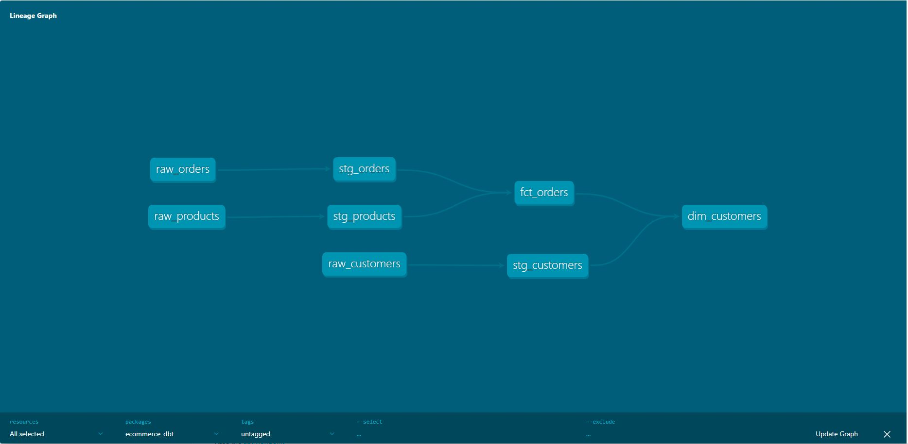

# 🛒 Modern Data Stack E-Commerce Pipeline
### dbt Core • DuckDB • Kimball Star Schema • Automated Schema Testing

[](https://docs.getdbt.com/)
[](https://duckdb.org/)
[](https://git-scm.com/)
[](#)

---

## 🎯 Executive Overview & Architecture

This repository delivers an end-to-end Modern Data Stack (MDS) transformation pipeline. It models high-velocity e-commerce event records into clean, production-grade dimensional marts following Ralph Kimball's dimensional modeling methodology.

### 📐 Lineage DAG (Data Flow)

<div align="center">
  
</div>

---

## 📂 Data Model & Layer Specifications

### 1. Raw Layer (Seeds)
- `raw_customers`: Base customer demographic records.
- `raw_products`: Catalog items, unit prices, and unit production costs.
- `raw_orders`: Transactional orders across completion, return, and cancellation statuses.

### 2. Staging Layer (Views)
- Standardizes column naming conventions.
- Casts strings to explicit temporal and numeric types (`DATE`, `DECIMAL(10,2)`, `INTEGER`).
- Enforces lowercase email normalization and constructs surrogate customer display names.

### 3. Marts Layer (Tables)
- **`fct_orders`**: Grain is one record per order line item. Enriched with financial metrics:
  - Gross Revenue: `quantity * unit_price`
  - Total COGS: `quantity * unit_cost`
  - Gross Profit: `Gross Revenue - Total COGS`
- **`dim_customers`**: Aggregated customer dimension tracking lifetime orders, completed lifetime revenue, initial conversion date, and recency.

---

## 🧪 Data Quality & Automated Test Suite

Data integrity is enforced via 11 automated dbt schema tests:
- **Primary Key Integrity:** `unique` and `not_null` assertions on all customer, product, and order identifiers.
- **Referential Integrity:** `relationships` test asserting foreign key alignment from `stg_orders.customer_id` to `stg_customers.customer_id`.

```powershell
dbt test
# PASS=11 WARN=0 ERROR=0